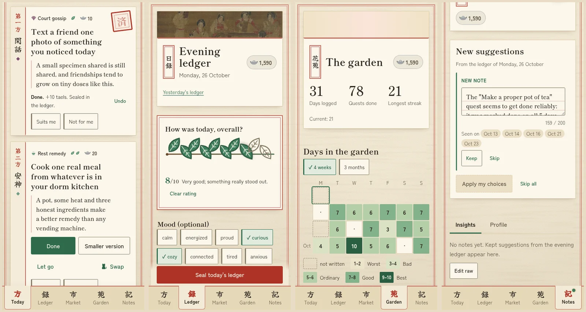
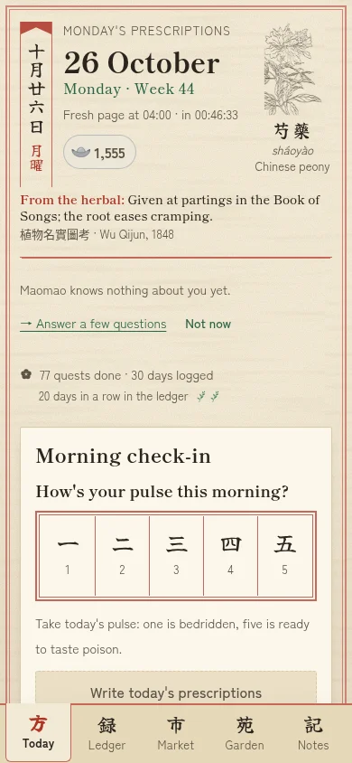
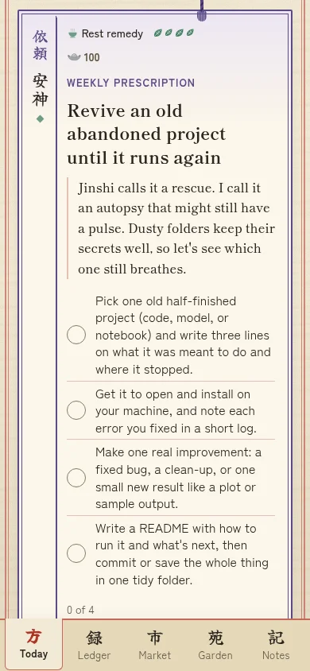
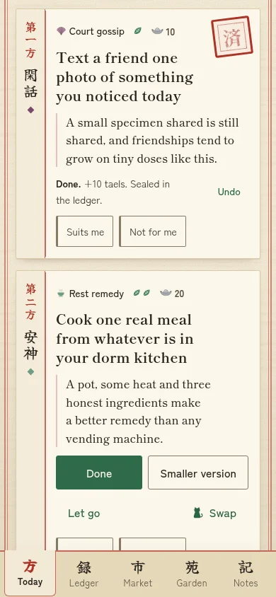
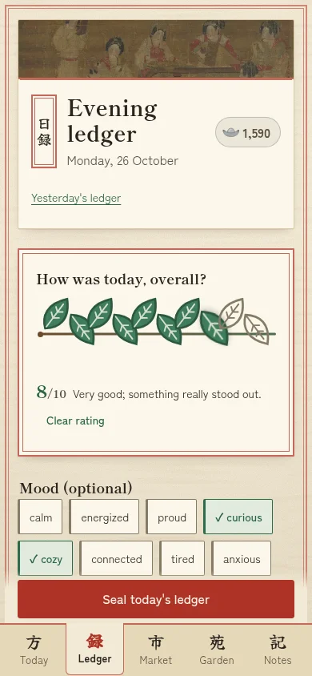
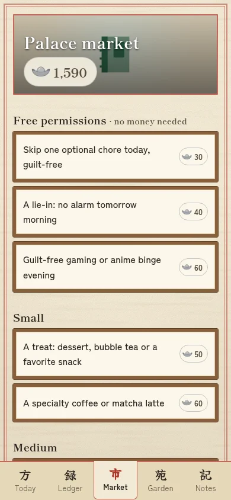
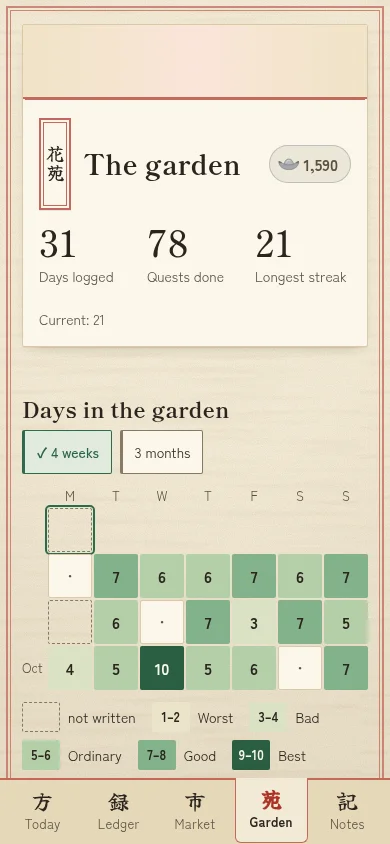
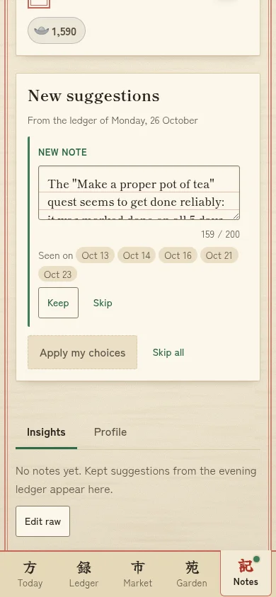
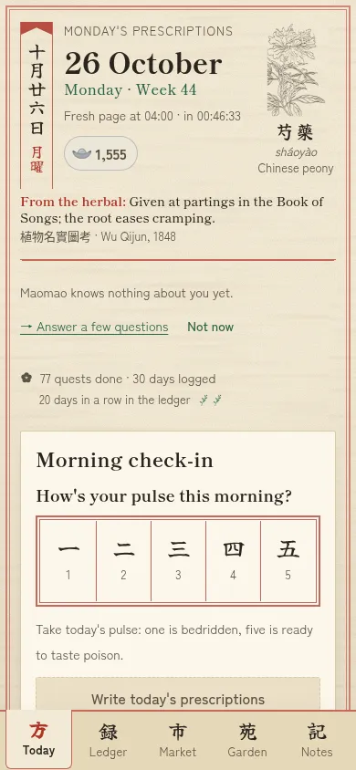
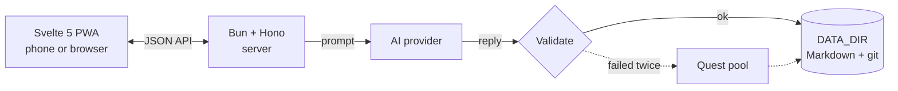

<div align="center">

<picture>
  <source media="(prefers-color-scheme: dark)" srcset="docs/readme/banner-dark.png">
  
</picture>

<br>


**[Features](#features) · [Quick start](#quick-start) · [AI providers](docs/ai-providers.md) · [Architecture](#architecture) · [Deployment](docs/deployment.md)**

</div>

Quest Journal is a self-hosted daily quest log and journal for one person. Each morning you report your energy and get
three small, real-life quests sized to it, plus a boss quest for the week. In the evening you rate the day and write a
few lines. Finished quests pay silver taels that you spend on real treats you set yourself.

The look and voice come from the apothecary's notebook in *The Apothecary Diaries*. Everything else is built to be
practical: it runs on your own PC, your phone uses it as an installable PWA, quests come from the AI model of your
choice (Claude, a local Ollama model or any OpenAI-compatible API), and the whole journal is plain Markdown and YAML in
a git repo you own.

<p align="center">
  
</p>

<p align="center"><sub>Screenshots use the built-in demo data (30 made-up days). Quests, boss and insight were written live by Claude Sonnet.</sub></p>

## Contents

- [Features](#features)
- [Screenshots](#screenshots)
- [Architecture](#architecture)
- [Tech stack](#tech-stack)
- [Quick start](#quick-start)
- [AI providers](#ai-providers)
- [Configuration](#configuration)
- [Deployment](#deployment)
- [Data and privacy](#data-and-privacy)
- [Development](#development)
- [Known limitations](#known-limitations)
- [How it was built](#how-it-was-built)
- [Credits](#credits)

## Features

<picture>
  <source media="(prefers-color-scheme: dark)" srcset="docs/readme/herb-ginseng-dark.png">
  
</picture>

- **Energy-sized daily quests.** A 1–5 check-in decides the mix: three easy, free, at-home quests (one of them a care
  quest) on a low day, one real stretch on a good one, and never more than one hard quest.
- **A weekly boss.** One larger challenge per week with checkpoints that pay out even if you don't finish it.
- **Evening ledger.** Rate the day in 1–10 herb leaves, pick mood tags, write a highlight, notes and gratitude, and
  note what you spent by category. Any day can be marked private.
- **Palace Market.** Spend taels on rewards from `rewards.yaml`, with cooldowns and prices tuned so a small treat
  comes about two or three times a week.
- **The Garden.** Your history as a grid of plots coloured by rating, with totals, streaks, a per-category tally and
  spending by type. Tap a plot to read that day or fill in a past one.
- **Learns only with consent.** After each evening the model may propose insights about you. Nothing is stored until
  you approve it.
- **Bring your own model.** Claude subscription, Claude API, local Ollama, or any OpenAI-compatible service. If the
  model fails, quests come from your own pool and the app keeps working.
- **Your data, in plain text.** Days are Markdown with YAML front matter, auto-committed to a local git repo. Edit them
  in any editor.
- **Gentle by design.** A missed day stays blank, never "failed". Streaks rest instead of breaking. No notifications,
  badges or reminders.

> 🌿 *Margin note from the apothecary:* at energy 1 the prescription is rest. Forcing a hard quest on a bad day is how
> you end up as a cautionary tale in someone else's notebook.

## Screenshots

| | | | |
|---|---|---|---|
|  |  |  |  |
| Morning check-in | The weekly boss | Quests, one sealed as done | Evening ledger |
|  |  |  | |
| Palace Market | The Garden | An insight waiting for approval | |

<details>
<summary><b>Animated walkthrough (phone size)</b></summary>
<br>
<p align="center"></p>
</details>

<details>
<summary><b>Pages at a glance</b></summary>
<br>

| Page | Path | What it's for |
|---|---|---|
| Today | `/` | Energy check-in, three quests and the week's boss. Mark each one done, partly done or let go; reroll with a reason; give 👍/👎. |
| Evening | `/evening` | Rating, mood tags, highlight, notes, gratitude, money spent. Optionally private. |
| Palace Market | `/market` | Spend taels on your rewards. |
| Garden | `/archive` | History, totals, streaks, category tally and spending. Unrated and unwritten days look different from bad days. |
| Notes | `/profile` | Your profile and the insights the app has learned, approved one by one. |

</details>

## Architecture

<picture>
  <source media="(prefers-color-scheme: dark)" srcset="docs/readme/herb-goji-dark.png">
  
</picture>

A single Bun process serves the Svelte SPA and a JSON API on loopback. All state lives in a separate data directory
that the server commits to git after each save.



1. **Prompt.** The morning prompt combines your profile (ground truth), approved insights, a one-line summary of each
   of the last 14 days, an avoid list of recent and rejected titles, and the categories you've neglected this week.
   Gratitude entries and private days are never included.
2. **Generate.** The configured provider is asked for structured JSON.
3. **Validate.** Every reply is checked before you see it: JSON shape, three distinct categories, difficulty slots
   for your energy, a money cap, no recent repeats and a set of safety rules. A bad reply gets one retry.
4. **Fall back.** If the retry fails or the model is unreachable, quests come from your own pool (respecting recency
   and cooldowns) and Today says so in a small banner.
5. **Persist.** Results are written to `days/YYYY-MM-DD.md` and committed. Saving an evening triggers a background
   job that may propose insights for `kb/insights.md`.

> 🧪 *Margin note:* the server plays Maomao's old job of food taster: nothing the model writes reaches your plate untested.

Rewards: easy 10 taels, medium 20, hard 35, weekly boss 100; partial completion pays about half. Every 7-day run
pays a 25-tael bonus  and a preserved herb that covers one missed
day (hold up to two). Details: [docs/how-it-works.md](docs/how-it-works.md).

## Tech stack

| Layer | Choice |
|---|---|
| Runtime | [Bun](https://bun.sh) ≥ 1.4 (workspaces: `server/`, `web/`) |
| API | [Hono](https://hono.dev), [Zod](https://zod.dev) schemas, `gray-matter` + `yaml` for the data files |
| Frontend | [Svelte 5](https://svelte.dev) SPA built with [Vite](https://vite.dev), installable PWA with an offline shell |
| AI | `claude` CLI, Anthropic Messages API, Ollama native `/api/chat`, OpenAI Chat Completions |
| Storage | Plain files in a git repository (no database) |
| Quality | TypeScript strict, `svelte-check --fail-on-warnings`, 918 `bun test` tests |

## Quick start

<picture>
  <source media="(prefers-color-scheme: dark)" srcset="docs/readme/herb-mint-dark.png">
  
</picture>

**Prerequisites:** [Bun](https://bun.sh) ≥ 1.4, `git`, and one AI provider (see [below](#ai-providers)).

```sh
git clone https://github.com/nurasik14/quest-journal.git
cd quest-journal
bun install
cp .env.example .env        # pick an AI provider in the AI section
bun run build
bun run start               # → http://localhost:4317
```

On first start the app creates your journal in `~/quest-data` (a new git repo) with a starter quest pool and market.
Fill in your profile on the Notes page; quests get much better once the model knows a little about you.

<sub>☕ Takes about as long as steeping a pot of tea.</sub>

### Try it with demo data

Runs against 30 made-up days in a scratch folder, so your real journal is never touched:

```sh
mkdir -p /tmp/qj-demo && bun run seed:demo /tmp/qj-demo --seed 1
bun run build
DATA_DIR=/tmp/qj-demo PORT=4399 SERVE_WEB=true AI_ENABLED=false bun server/src/index.ts
```

Open http://localhost:4399. With `AI_ENABLED=false` quests come from the pool; set e.g.
`AI_PROVIDER=ollama AI_MODEL=qwen3.5` instead to watch a model write them.

<details>
<summary>Seeder options</summary>
<br>

The seeder writes ratings, gaps, an unrated day, a private day and let-go quests, ending yesterday, so the Garden is
full whenever you run it. `--today YYYY-MM-DD` pins the dates and `--broken` adds one unreadable page. The same
`--seed` and `--today` always give the same output. It refuses to run on `~/quest-data`, inside this repo, or on a
non-empty directory.

</details>

## AI providers

Set `AI_PROVIDER` in `.env`. The rest of the app behaves the same with every provider.

| Provider | `AI_PROVIDER` | Cost | Quest quality | Journal leaves the PC? |
|---|---|---|---|---|
| Claude subscription (Pro/Max) via the `claude` CLI | `claude-cli` (default) | included in your plan | best | yes, to Anthropic |
| Claude API key | `anthropic` | a few cents a day | best | yes, to Anthropic |
| Ollama, local model | `ollama` | free | good with 7–10B models | **no** |
| Gemini, Groq, OpenRouter free tiers | `openai` | free within limits | good | yes, to that provider |
| OpenAI, LM Studio, llama.cpp, vLLM | `openai` | varies | varies | local servers: no |

Setup for each option, local model benchmarks, JSON-mode settings and troubleshooting are in
**[docs/ai-providers.md](docs/ai-providers.md)**. To check what the server picked, read the `AI:` line in the startup
log or `curl -s localhost:4317/api/health`.

## Configuration

All settings are optional environment variables, read from `.env` (also by the systemd unit). The most common:

| Variable | Default | Purpose |
|---|---|---|
| `DATA_DIR` | `~/quest-data` | Your private journal repo. Must not be inside this repo. |
| `HOST` / `PORT` | `127.0.0.1` / `4317` | Bind address. Keep loopback and use `tailscale serve` for the phone. |
| `TZ` | system | IANA time zone for your logical day. |
| `DAY_ROLLOVER_HOUR` | `4` | A "day" runs 04:00 to 03:59. |
| `ALLOWED_HOSTS` | `localhost,127.0.0.1` | Exact host names allowed (DNS-rebinding guard). |
| `AI_PROVIDER` / `AI_MODEL` | `claude-cli` / per provider | Which model writes quests. |
| `AI_ENABLED` | `true` | `false` always uses your quest pool. |

<details>
<summary>Full <code>.env</code> reference</summary>
<br>

```ini
# journal and server
DATA_DIR=~/quest-data        # your private data repo; created and git-initialised on first start
HOST=127.0.0.1               # keep loopback; the phone goes through `tailscale serve`
PORT=4317
TZ=Asia/Almaty               # your IANA time zone (default: the system's)
DAY_ROLLOVER_HOUR=4          # a "day" runs 04:00 to 03:59
ALLOWED_HOSTS=localhost,127.0.0.1,pc.your-tailnet.ts.net   # exact names only, no wildcards
GIT_ENABLED=true             # auto-commit DATA_DIR after saves (never pushes)
GIT_DEBOUNCE_MS=5000
STREAK_BONUS=25

# AI
AI_ENABLED=true              # false = always use your quest pool
AI_PROVIDER=claude-cli       # claude-cli | anthropic | ollama | openai
AI_MODEL=                    # default per provider: sonnet | claude-sonnet-5 | qwen3.5 | gpt-4o-mini
AI_BASE_URL=                 # HTTP providers only; defaults: api.anthropic.com | localhost:11434 | api.openai.com/v1
AI_API_KEY=                  # HTTP providers; falls back to ANTHROPIC_API_KEY (anthropic) or OPENAI_API_KEY (openai)
AI_JSON_MODE=schema          # schema | json | off
AI_TIMEOUT_MS=60000          # per call; 180000 by default for ollama
AI_BOSS_ON_OPEN=true         # write the weekly boss with AI on the first open of the week
OLLAMA_NUM_CTX=16384         # ollama only
CLAUDE_BIN=claude            # claude-cli only; bare name: looked up on PATH, then ~/.local/bin
DEBUG=                       # 1 = keep the last 20 raw AI replies at GET /api/debug/ai
```

`.env.example` has the same list with comments.

</details>

## Deployment

The app is meant to run on your own machine and be reached from your phone over [Tailscale](https://tailscale.com).
[docs/deployment.md](docs/deployment.md) covers:

- **Phone access:** `tailscale serve --bg 4317` for HTTPS inside your tailnet, then install the PWA.
- **Background service:** a systemd user unit in `deploy/quest-journal.service`.
- **First-install checklist** to confirm the model, the phone and git commits all work.
- **Backups** of your journal to a private remote or a second disk.

> [!WARNING]
> Never expose the app with `tailscale funnel` or a public port. It has no login of its own; your tailnet is the only
> security boundary.

## Data and privacy

<picture>
  <source media="(prefers-color-scheme: dark)" srcset="docs/readme/herb-licorice-dark.png">
  
</picture>

| What | Where | Who sees it |
|---|---|---|
| Days, weeks, profile, insights, quest pool, rewards, purchases | `DATA_DIR` (`days/`, `weeks/`, `kb/`, `*.yaml`) | Only you. Committed locally, never pushed. |
| Profile, approved insights, last 14 days of notes and ratings | Sent in the quest prompt | Your AI provider (nobody, with a local model) |
| Gratitude entries and days marked private | `DATA_DIR` only | Never sent anywhere |

- Notes and insights always render as plain text; nothing from your files is rendered as HTML.
- If a hand edit breaks a file, the app shows it read-only with the line number and never overwrites it.
- The repo only contains public-domain and original artwork. Character stickers used in the author's own copy are
  personal-use only and gitignored, so a fresh clone shows empty sticker slots.

<sub>🏮 What is written in the Inner Court stays in the Inner Court.</sub>

## Development

```sh
bun install
bun run dev          # API on :4317 + Vite on :5173 with hot reload
```

| Script | Does |
|---|---|
| `bun run dev` | API and Vite dev server with hot reload (open http://localhost:5173) |
| `bun run build` | Builds the web app and the server bundle |
| `bun run start` | Production server on `HOST:PORT` |
| `bun run typecheck` | `tsc` and `svelte-check --fail-on-warnings` |
| `bun test` | Unit and API tests (temp dirs only, never calls a real model) |
| `bun run econ:sim` | Simulates the tael economy over several weeks |
| `bun run seed:demo <dir>` | Writes a demo journal |

### Project structure

```
server/src/       API, quest generation, AI providers, validation, economy, insights, git
server/test/      bun test suites
web/src/routes/   one Svelte component per page
web/src/lib/      API client, state, theme, components, all UI copy (copy.ts)
web/public/       PWA manifest, icons, decor (herb plates and SVG motifs)
docs/             architecture, design system, sprint plans and reviews, demo screenshots, guides
deploy/           systemd user unit
scripts/          asset helpers (font subsets, herb plates, icons, README art)
.claude/agents/   the Claude Code agents that designed, built and tested the app
```

[docs/ARCHITECTURE.md](docs/ARCHITECTURE.md) is the source of truth for design decisions, and
[docs/design/design-system.md](docs/design/design-system.md) for the visual system.

## Known limitations

- Single user, no accounts. The tailnet is the security boundary.
- Offline, the app shows the last loaded shell read-only; saves need the server and nothing is queued. Retrying a save
  is always safe and never duplicates a quest, entry or purchase.
- YAML comments can be lost when a file has to be re-serialised (git history keeps the old version).
- Small local models break the quest rules more often than Claude, which means more pool days.
- No random events yet; the weekly boss is the only extra challenge.

## How it was built

A team of Claude Code agents designed and built the app in short sprints: an architect, a behavioural psychologist
(motivation and the tael economy), a designer, a builder and a tester. Their plans, reviews and test reports are in
`docs/sprints/` and `docs/test-reports/`, the agent definitions in `.claude/agents/`, and the workflow in `CLAUDE.md`.

## Credits

- Herb plates: *Zhiwu mingshi tukao* 植物名實圖考, Wu Qijun, 1848 (public domain, via Wikimedia Commons).
- Fonts: Shippori Mincho B1, Zen Kaku Gothic New and Yuji Syuku (SIL Open Font License 1.1).
- Full image sources and licenses: [web/public/IMAGE_SOURCES.md](web/public/IMAGE_SOURCES.md). README art is generated
  from those assets by `scripts/make-readme-art.py`.
- Inspired by *The Apothecary Diaries* (*Kusuriya no Hitorigoto*) by Natsu Hyuuga. This is an unofficial fan project
  and is not affiliated with or endorsed by the rights holders.

<br>

<p align="center">
  <picture>
    <source media="(prefers-color-scheme: dark)" srcset="docs/readme/cat-dark.png">
    
  </picture>
  &nbsp;
  
  <br>
  <sub><i>Inspected by the palace cat. Approved, pending one dried fish (10 taels).</i></sub>
</p>
